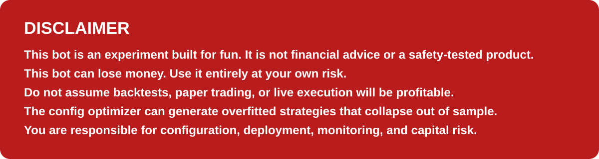
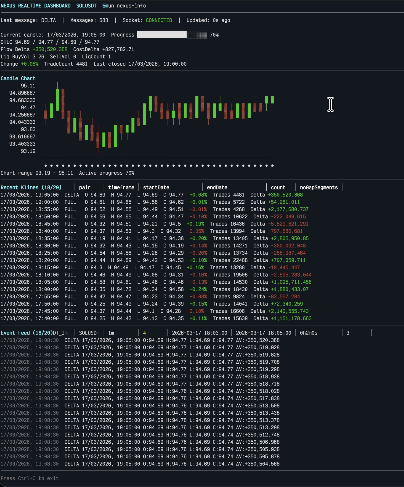
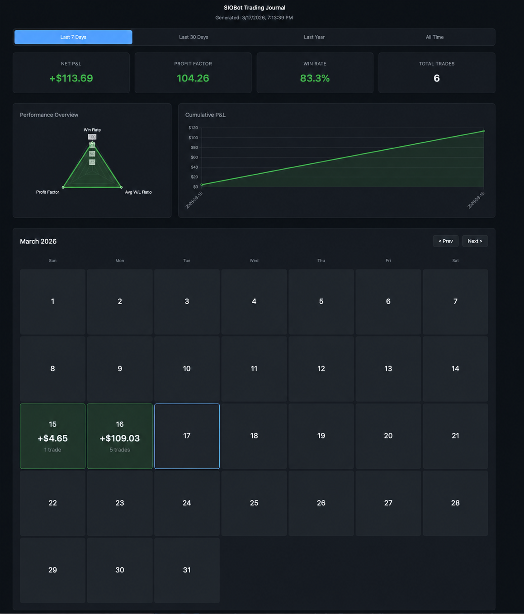
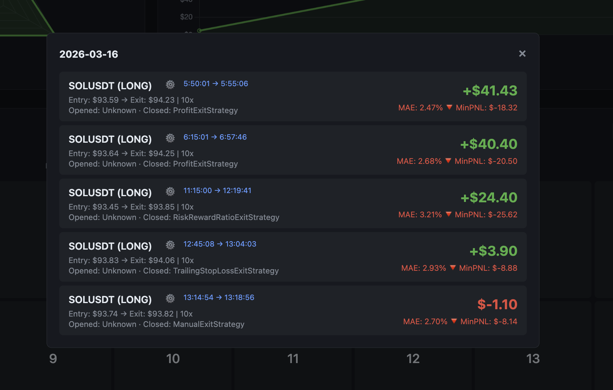
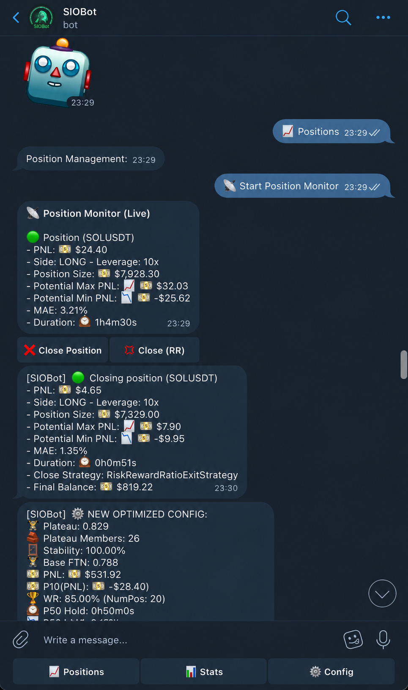

# Sio Bot



Sio Bot is a Bun + TypeScript trading bot built around a modular runtime, configurable
strategy stack, paper/live exchange adapters, a backtesting engine, and an optimizer for
searching strategy parameters. It relies on the sio-Nexus project for realtime and
historical market data over Unix sockets: [sergi-io/sio-nexus](https://github.com/sergi-io/sio-nexus).

This project is licensed under the GNU General Public License v3.0 only. See [LICENSE](./LICENSE).

## Some Screenshots

<div style="display:flex; flex-direction:column; gap:16px;">









</div>

The project is organized to support three main workflows:

- realtime trading in paper mode or live mode
- offline backtesting and configuration optimization
- post-trade reporting through a generated trading journal

## What It Does

- Connects to sio-Nexus for market data and historical klines
- Runs a configurable strategy pipeline with TA, risk, order, and position managers
- Supports paper trading with persisted local state
- Supports live execution on Phemex
- Runs backtests on historical data
- Optimizes bot configuration with brute force or a genetic algorithm
- Generates a static HTML trading journal from recorded position history
- Includes terminal dashboards for indicators and Nexus data

## Architecture

High-level runtime flow:

1. Load `.env` and `bot-config.json`
2. Choose exchange adapter:
   - `PaperTradeExchange` for realtime paper trading
   - `PhemexExchange` for live trading
   - `FakeExchange` for backtests
3. Warm up kline buffers from Nexus/history
4. Feed klines into the TA manager
5. Evaluate enter/exit strategies
6. Apply risk rules and sizing
7. Open/close positions and persist results
8. Regenerate the journal when positions are closed

Core modules:

- `src/siobot/`: main runtime orchestration
- `src/strategies/`: enter and exit strategy implementations
- `src/risk/`: leverage, sizing, and stop/risk controls
- `src/exchanges/`: Phemex, paper-trade, fake exchange, Nexus clients
- `src/ta/`: indicator implementations and terminal dashboard
- `src/backtester/`: backtest runner, reports, optimizer
- `src/journal/`: static journal generation
- `src/utils/db/`: SQLite persistence for paper-trade state and position history

## Requirements

- [Bun](https://bun.sh/)
- A running `sio-nexus` instance from [sergi-io/sio-nexus](https://github.com/sergi-io/sio-nexus)
- Unix socket access to Nexus query and aggregate feeds
- Phemex API credentials if you want to trade live

## Quick Start

1. Install dependencies:

```bash
bun install
```

2. Create your local environment file:

```bash
cp .env-sample .env
```

3. Review and update:

- `bot-config.json`
- Nexus socket paths
- Telegram settings
- paper-trade or live-trade settings
- backtest date range

4. Start sio-Nexus.

5. Run the bot in paper mode:

```bash
bun run dev
```

By default, paper mode is controlled by `SIOBOT_PAPER_TRADE_ENABLED=true` in `.env`.
Set it to `false` only when you are ready to use live exchange execution.

## Configuration

The bot reads configuration from two places:

- `.env`: environment, logging, exchange credentials, journal, sockets, deploy settings
- `bot-config.json`: trading symbol, timeframes, strategy toggles, optimizer weights, risk limits

Important environment variables:

- `SIOBOT_PAPER_TRADE_ENABLED`
- `SIOBOT_PAPER_TRADE_INITIAL_BALANCE`
- `SIOBOT_EXCHANGE_ID` (`phemex` or `bitget`)
- `SIOBOT_PHEMEX_API_ID`
- `SIOBOT_PHEMEX_API_SECRET`
- `SIOBOT_BITGET_API_KEY`
- `SIOBOT_BITGET_API_SECRET`
- `SIOBOT_BITGET_PASSWORD`
- `SIOBOT_BITGET_TESTNET_ENABLED`
- `SIOBOT_BACK_TEST_DATE_START`
- `SIOBOT_BACK_TEST_DATE_END`
- `SIOBOT_LOG_ENABLED`
- `SIOBOT_LOG_LEVEL`
- `SIOBOT_JOURNAL_DIR`
- `SIOBOT_NEXUS_AGGR_SOCKET_PATH`
- `SIOBOT_NEXUS_QUERY_SOCKET_PATH`

Important `bot-config.json` fields:

- `assetSymbol`
- `timeFramesFromNexus`
- `timeFrameToTrade`
- `timeFrameToDetectRegime`
- `regimePrefilter_Enabled`
- `regimePrefilter_EMAPeriod`
- risk settings such as leverage and order sizing
- enter strategy flags and parameters
- exit strategy flags and parameters
- genetic optimizer population, generations, and scoring weights

## Commands

### Development and Runtime

```bash
bun run dev
bun run dev:indicators
bun run indicator-dashboard
bun run nexus-info
bun run nexus-dashboard
```

- `bun run dev`: watch mode, generates journal templates, then runs `src/main.ts run`
- `bun run dev:indicators`: watch mode with indicator dashboard
- `bun run indicator-dashboard`: run the bot with the realtime indicator TUI
- `bun run nexus-info`: inspect Nexus query-socket coverage and ranges
- `bun run nexus-dashboard`: realtime terminal dashboard for a symbol/timeframe

### Backtesting and Optimization

```bash
bun run backtest
bun run backtest -- 2025-12-01 2025-12-31
bun run config-optimizer-brute-force
bun run config-optimizer-genetic
bun run config-optimizer-genetic -- --fast
```

- `backtest`: runs the bot against historical data using `FakeExchange`
- `config-optimizer-brute-force`: exhaustively evaluates optimizable config ranges
- `config-optimizer-genetic`: evolutionary search over the config space with walk-forward out-of-sample scoring
- `--fast`: reduced genetic search for quicker iteration

Optimizer outputs are written under `outputs/configs/`.

### Reports and Utilities

```bash
bun run generate-journal
bun run open-journal
bun run build
bun run deploy
bun run apply-best-config -- 1
```

- `generate-journal`: rebuilds the static journal from `data/position_history.sqlite`
- `open-journal`: pulls the remote position DB, regenerates the journal, then serves it locally
- `build`: compiles a Linux x64 Bun binary to `build/x64/sio-bot`
- `deploy`: builds, syncs the binary over SSH, and restarts the remote systemd service
- `apply-best-config`: copies an optimizer snapshot into `bot-config.json`

### Quality Checks

```bash
bun run lint
bun run typecheck
bun run test
```

## Data and Output Files

Runtime data and generated artifacts are stored in these locations:

- `data/fake_exchange.sqlite`: persisted paper-trade balance and open positions
- `data/position_history.sqlite`: closed-position history used by the journal
- `outputs/journal/`: static HTML trading journal
- `outputs/backtest/report.html`: generated backtest report
- `outputs/configs/`: optimizer snapshots, reports, and stability heatmaps
- `build/x64/sio-bot`: compiled production binary

## Strategy Configuration Model

`bot-config.json` is not a flat settings file in the usual sense. Many entries encode both
the current value and optimization metadata. Keys prefixed with numeric groups such as
`0|...` and `1|...` are used to organize parameters and strategy blocks for optimization and
serialization. The `BotConfig` class maps those serialized values back into strongly typed
config objects at runtime.

In practice:

- boolean toggles decide whether a strategy/risk rule is active
- numeric values can define `from`, `to`, and `step` ranges for optimization
- string values can define selectable options
- binary values are used for bitmask-style settings such as trading days

## Typical Workflow

For paper trading:

1. Start `sio-nexus`
2. Set `SIOBOT_PAPER_TRADE_ENABLED=true`
3. Tune `bot-config.json`
4. Run `bun run dev`
5. Review positions and journal output in `outputs/journal/`

For research and optimization:

1. Set backtest dates in `.env`
2. Tune the base search space in `bot-config.json`
3. Run `bun run backtest`
4. Run `bun run config-optimizer-genetic`
5. Review `outputs/configs/`
6. Apply a chosen snapshot with `bun run apply-best-config -- <snapshot>`

## Project Layout

```text
src/
  siobot/      Bot runtime orchestration
  backtester/     Backtesting, optimization, reports
  comms/          Telegram integration
  domain/         Core trading types
  exchanges/      Exchange adapters and Nexus clients
  journal/        Static journal generator
  orders/         Order orchestration
  positions/      Position tracking and persistence
  risk/           Risk strategies and sizing
  strategies/     Enter and exit strategy implementations
  ta/             Technical indicators and dashboards
  utils/          Shared helpers, DB access, klines utilities
scripts/
  deploy.sh
  apply-best-config.sh
  open-journal.sh
```

## Operational Notes

- Live mode uses Phemex through `ccxt`.
- Paper mode still consumes realtime data from sio-Nexus.
- Position history is persisted automatically when trades close.
- The journal can regenerate automatically after closed trades and can also be forced manually.
- The optimizer saves ranked config snapshots automatically to `outputs/configs/`.

## Current Caveats

- Nexus socket settings use `SIOBOT_NEXUS_*` variables. The default socket paths retain
  the external `sio-nexus` service names for compatibility.
- The historical download pipeline appears partially wired and should be treated as
  experimental until its command path is reconciled with `src/main.ts`.

## Development Notes

- Runtime entrypoint: `src/main.ts`
- Main runtime class: `src/siobot/SioBot.ts`
- Config schema and serialization: `src/siobot/BotConfig.ts`
- The repository uses strict TypeScript and Bun runtime APIs.
- Tests are colocated as `*.test.ts` files next to source modules.

## License

GPL-3.0-only. See [LICENSE](./LICENSE) for the full text.
